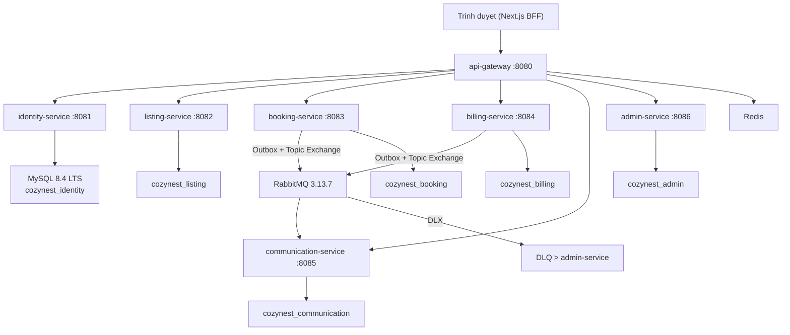
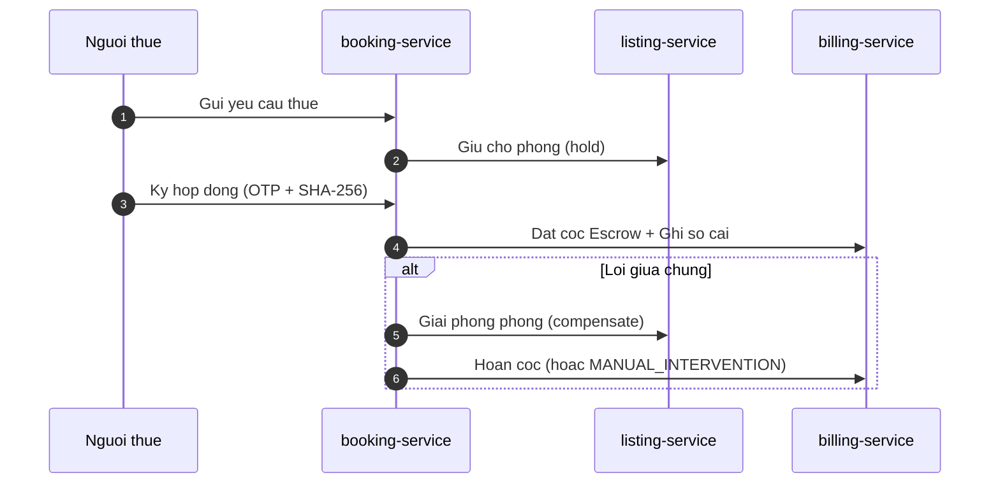

# SPRINT 3 REVIEW — TO AM / COZYNEST

> Ngay Sprint Review: 13/11/2026
> Nhanh ma nguon: `feat/saga-01-escrow-01` (BE va FE)
> Tac gia: catim07 (Cuong — Tech Lead, BE Core, Fintech, Security, Legal)

---

## A. SPRINT GOAL VA PHAM VI

### Sprint Goal
> Nen tang kiem chung va hop phap truoc, roi khep kin chu trinh dat xem > dat thue > ky hop dong > coc > hoa don > thanh toan, voi so cai bat bien va kiem soat rui ro. Cuoi sprint co QA tien tren staging voi sandbox.

### Doi chieu voi lo trinh goc

| | Backlog goc (Sprint 3) | Thuc te |
|---|---|---|
| So the | 12 | 28 |
| Story points | 34 SP | 128 SP |
| Stack | React + Vite + Node/Express | Next.js 16.2 + Spring Boot 4.1 microservices |
| Tang | 3.8x so the, 3.8x diem |

### 12 the goc cua Sprint 3 va anh xa hien tai

| The goc | Anh xa hien tai | Ghi chu |
|---|---|---|
| APPT-01 | APPT-RENT-BE / APPT-RENT-FE | Gop dat lich + dat thue |
| APPT-02 | (da xong tu Sprint 2: APPT-02-BE/FE) | Duyet lich hen |
| RENT-01 | APPT-RENT-BE | Yeu cau thue, giu cho |
| RENT-02 | APPT-RENT-FE | Giao dien yeu cau thue |
| CONTRACT-01 | CONTRACT-BE | Hop dong dien tu, ky OTP |
| CONTRACT-02 | CONTRACT-02 | Phu luc, gia han, dong thue |
| CONTRACT-03 | CONTRACT-FE | Giao dien hop dong |
| METER-01 | METER-01 | Chi so dien nuoc |
| INVOICE-01 | INVOICE-01/02 | Hoa don hang thang |
| INVOICE-02 | INVOICE-01/02 | Bien lai, nhac no |
| PAY-01 | PAY-01 | Cong thanh toan + webhook |
| PAY-02 | PAY-02 | Doi soat hang dem |

### 16 the THEM MOI so voi ban goc

| The moi | Ly do (1 cau) |
|---|---|
| LEGAL-02 | Bat buoc tham dinh phap ly truoc khi nhan tien that (ND 52/2024, ND 117/2025) |
| HARDEN-01 | Va no ky thuat Sprint 1-2 truoc khi mo giao dich tien |
| SAGA-01 | Dam bao nhat quan xuyên service khi dat thue - coc - ky |
| LEDGER-01 | So cai ke toan kep bat bien cho moi giao dich tien |
| LEDGER-02 | Toan ven so cai, duyet 2 nguoi, xuat bao cao |
| ESCROW-01 | Giu coc, hoan huy, rut tien (hien SANDBOX) |
| FIN-RISK-01 | Han muc, dong bang, canh bao bat thuong |
| REFUND-01 | Hoan tien ra ngan hang cho nguoi thue |
| KYC-03 | Xac minh quyen cho thue, huy hieu tin xac thuc |
| ROOM-03 | Bo sung du lieu tin dang, quy tac sua tin |
| DEVOPS-02 | Moi truong dev/staging/prod, feature flag tien |
| STORAGE-01 | Kho luu tru rieng tu, ma hoa, signed URL |
| BROKER-01 | RabbitMQ outbox, DLQ, event catalog |
| SEC-PROD-01 | 2FA, Vault, quet CI, xoay khoa |
| PHONE-OTP-01 | Xac thuc SDT, kenh du phong |
| QA-FINTECH | E2E chu trinh tien, sandbox, go/no-go |

### Thay doi lon so voi lo trinh goc
1. **Doi stack**: React+Vite+Node/Express sang Next.js 16.2 + Spring Boot 4.1 microservices (ghi ADR)
2. **Dia gioi 2 cap**: Theo NQ 202/2025/QH15, bo cap quan/huyen tu 01/07/2025
3. **Yeu cau tien that va du lieu ca nhan that**: Phat sinh nhom the phap ly, bao mat, rui ro, QA fintech
4. **So cai ke toan kep**: Yeu cau bat bien, double-entry, ArchUnit cam ghi ngoai LedgerService

---

## B. KIEN TRUC SPRINT 3

### So do service

### Luong Saga dat thue

### BFF HttpOnly Cookie

- Token JWT (RS256) chi ton tai trong cookie `HttpOnly`, `SameSite=Lax`, `Secure` (production)
- Next.js BFF Route Handler (`/api/v1/[...path]`) inject `Authorization: Bearer` server-side
- JS trinh duyet KHONG doc duoc token qua `document.cookie` hay `localStorage`
- CSRF: kiem tra `Origin`/`Referer` cho request ghi (`POST`/`PUT`/`PATCH`/`DELETE`)

---

## C. SO LIEU SPRINT 3 [CHAY LAI HOM NAY]

### Lenh da chay

| Lenh | Ket qua | Nhan nguon |
|---|---|---|
| `.\gradlew.bat clean test --no-build-cache --no-daemon` | BUILD SUCCESSFUL 2m 34s | [CHAY LAI HOM NAY] |
| BE test (JUnit XML) | 396 tests, 0 failures, 0 skipped | [CHAY LAI HOM NAY] |
| `npx eslint . --max-warnings=0` | PASS (0 errors, 0 warnings; chi co deprecation config plugin) | [CHAY LAI HOM NAY] |
| `npx tsc --noEmit` | PASS (exit 0) | [CHAY LAI HOM NAY] |
| `npx vitest run` | 17 files, 77/77 tests PASS (4.23s) | [CHAY LAI HOM NAY] |
| `npm run build` | PASS (98 routes, 7 API routes) | [CHAY LAI HOM NAY] |

### BE test theo module [CHAY LAI HOM NAY, 13/11/2026]

| Module | Tests | Failures | Skipped |
|---|---|---|---|
| admin-service | 10 | 0 | 0 |
| api-gateway | 8 | 0 | 0 |
| billing-service | 32 | 0 | 0 |
| booking-service | 43 | 0 | 0 |
| common | 25 | 0 | 0 |
| communication-service | 14 | 0 | 0 |
| identity-service | 181 | 0 | 0 |
| listing-service | 83 | 0 | 0 |
| **Tong** | **396** | **0** | **0** |

### So lieu khac [CHAY LAI HOM NAY hoac DOC TU MA]

| Chi so | Gia tri | Nhan nguon |
|---|---|---|
| BE controllers | 48 | [DOC TU MA] |
| BE test classes | 103 | [DOC TU MA] |
| BE Flyway migrations | 40 files | [DOC TU MA] |
| FE page.tsx (routes) | 98 | [DOC TU MA] |
| FE test files | 177 | [DOC TU MA] |
| FE i18n keys (VI/EN) | 1936 / 1936 (100% parity) | [CHAY LAI HOM NAY] |
| BE Sprint 3 commits | 22 | [CHAY LAI HOM NAY] |
| FE Sprint 3 commits | 16 | [CHAY LAI HOM NAY] |
| BE Sprint 3 diff | 464 files, +20,238 -2,571 | [CHAY LAI HOM NAY] |
| FE Sprint 3 diff | 204 files, +7,975 -3,377 | [CHAY LAI HOM NAY] |
| Tac gia BE Sprint 3 | catim07 (22 commits) | [CHAY LAI HOM NAY] |
| Tac gia FE Sprint 3 | catim07 (16 commits) | [CHAY LAI HOM NAY] |

### GitHub Actions CI [CHAY LAI HOM NAY, 12/11/2026]

| Repo | Nhanh | Workflow | Run ID | Ket qua |
|---|---|---|---|---|
| accommodation-service | feat/legal-02-harden-01-appt-contract | Backend CI Pipeline | 43171648862 | SUCCESS |
| accommodation-service | feat/legal-02-harden-01-appt-contract | CI Security & Test Gate | 43171648805 | SUCCESS |
| accommodation-service | feat/saga-01-escrow-01 | Backend CI Pipeline | 43171650279 | SUCCESS |
| accommodation-service | feat/saga-01-escrow-01 | CI Security & Test Gate | 43171650286 | SUCCESS |
| accommodation-web | feat/legal-02-harden-01-appt-contract | Frontend CI Pipeline | 43169862899 | SUCCESS |
| accommodation-web | feat/saga-01-escrow-01 | Frontend CI Pipeline | 43169863227 | SUCCESS |

---

## D. BANG TRANG THAI TRUNG THUC 28 THE

### Tong hop theo nhan trang thai

| Nhan trang thai | So the | Diem |
|---|---|---|
| PARTIAL (co ma, chua kiem chung het checklist) | 22 | 104 |
| HUMAN (cho con nguoi: luat su, ke toan, ha tang) | 1 | 3 |
| SANDBOX (chay duoc nhung mo phong, chua tien that) | 5 | 21 |
| DEMO-OK | 0 | 0 |
| NOT-DONE | 0 | 0 |
| **Tong** | **28** | **128** |

> **Giai thich:** Khong co the nao dat DEMO-OK vi buoi review nay chua co buoc chay demo tren trinh duyet that va chup anh tung buoc. Trang thai `PARTIAL` la trung thuc: ma nguon co, test pass, nhung nhieu dòng checklist chi co ma chua chay kiem chung doc lap (nhan [DOC TU MA] hoac [THEO BAO CAO]).

### Chi tiet theo nhom

**Nhom HUMAN (1 the, 3 diem):**

| The | Diem | Ly do HUMAN |
|---|---|---|
| LEGAL-02 | 3 | Toan bo 7 cau hoi phap ly can luat su/ke toan tra loi. Da co de xuat ky thuat (ADR-008/010) nhung CHUA co van ban phap ly chinh thuc. |

**Nhom SANDBOX (5 the, 21 diem) — chay duoc nhung dung co mo phong:**

| The | Diem | Gi la SANDBOX |
|---|---|---|
| PAY-01 | 8 | `fintech.mode=SANDBOX_ONLY`, webhook simulate, chua co cong thanh toan that |
| PAY-02 | 3 | Doi soat chi hoat dong tren du lieu sandbox |
| ESCROW-01 | 5 | `money.custody.enabled=false`, module escrow bi khoa |
| REFUND-01 | 3 | Hoan tien chi la ghi so cai sandbox, chua chuyen tien that |
| QA-FINTECH | 5 | Chua chay tren staging voi sandbox that, chua co checklist go/no-go ky |

**Nhom PARTIAL (22 the, 104 diem):**
Tat ca deu co ma nguon, test pass, nhung chua kiem chung day du tung dong checklist. Xem chi tiet tai `docs/review/SPRINT3-FEATURE-INVENTORY.md`.

### Nhung gi KHONG hoan thanh hoac dang cho ben ngoai

| Hang muc | Ly do | Thoc the |
|---|---|---|
| Tham van luat su/ke toan | Chua thue/gap luat su | LEGAL-02 |
| Cong thanh toan that | Chua ky hop dong PSP | PAY-01, ESCROW-01 |
| SMS provider that | Chua co hop dong Zalo ZNS / SMS Brandname | PHONE-OTP-01 |
| Staging/Production | Chua co VPS/Cloud, ten mien, DNS | DEVOPS-02 |
| Vault/Secret Manager | Chua co Vault production | SEC-PROD-01 |
| Kiem thu thiet bi that (iOS Safari, Zalo) | Can QA tren dien thoai that | APPT-RENT-FE |
| Ky Go/No-Go tai chinh | Can 2 nguoi (co Cuong) ky | QA-FINTECH |

---

## E. BUG-FOUND VA RUI RO

### Bug phat hien khi kiem tra [CHAY LAI HOM NAY / THEO BAO CAO]

| # | Muc do | Mo ta | Cach tai hien | Nguon |
|---|---|---|---|---|
| BUG-01 | THAP | BE Gradle exit code 1 do stderr canh bao deprecation API (`JwksTokenValidator.java`) du BUILD SUCCESSFUL | Chay `.\gradlew.bat clean test` tren PowerShell, exit code 1 vi stderr | [CHAY LAI HOM NAY] |
| BUG-02 | TRUNG | Playwright E2E: 71/246 test FAIL (phan lon 401/timeout tai `/admin-*`, `/landlord-*`, `/support`) | Chay `npx playwright test` tren nhanh hien tai | [THEO BAO CAO S3-COMPLETE] |
| BUG-03 | THONG TIN | RabbitMQ 3.13.7 het Community Support tu 09/2024 | Kiem tra phien ban trong docker-compose.yml | [DOC TU MA] |

### Rui ro

| Rui ro | Muc do | Giam thieu |
|---|---|---|
| Toan bo thanh toan la SANDBOX | CAO | Feature flag `fintech.mode`, chi bat sau LEGAL-02 + hop dong PSP |
| OTP gui qua Mailpit, chua co SMS | TRUNG | Co co du phong provider (Zalo > SMS), chi can cau hinh |
| Chua co kiem thu tren thiet bi that | TRUNG | Se lam o Sprint 4 (QA-K6) |
| Chi 1 tac gia (catim07) tren git | THAP | Do Agent (Antigravity) thuc hien, cac dev review tren Trello |

---

## F. DONG GOP THEO THANH VIEN

### Theo ke hoach vs thuc te git

| Thanh vien | The ke hoach | Diem ke hoach | Tac gia git Sprint 3 |
|---|---|---|---|
| Cuong (Dev 1) | LEDGER-01, PAY-01, PAY-02, SAGA-01, HARDEN-01, LEGAL-02 | 32 | catim07 — 38 commits (22 BE + 16 FE) |
| Dev 2 | LEDGER-02, ESCROW-01, CONTRACT-BE, CONTRACT-02, APPT-RENT-BE, FIN-RISK-01 | 26 | (lech: catim07 thuc hien code) |
| Dev 3 | DASH-FIX-1, APPT-RENT-FE, CONTRACT-FE, ROOM-03, KYC-03, STORAGE-01 | 24 | (lech: catim07 thuc hien code) |
| Dev 4 | METER-01, INVOICE-01/02, PAY-VIP-FE, REFUND-01, DASH-STATS-BE | 23 | (lech: catim07 thuc hien code) |
| Dev 5 | DEVOPS-02, BROKER-01, SEC-PROD-01, PHONE-OTP-01, QA-FINTECH | 23 | (lech: catim07 thuc hien code) |

> **Ghi chu trung thuc:** Tren git, toan bo 38 commit Sprint 3 deu la cua `catim07`. Dieu nay cho thay ma nguon Sprint 3 hien tai duoc thuc hien boi 1 nguoi (ho tro boi Antigravity AI Agent), KHONG phan phoi deu nhu ke hoach 5 dev. Cac thanh vien khac can review va nhan viec cho Sprint 4.

### 3 diem noi bat nen noi cua moi nguoi (theo ke hoach)

**Cuong (Tech Lead):**
1. Thiet ke so cai ke toan kep bat bien voi trigger MySQL chan UPDATE/DELETE
2. De xuat mo hinh dong tien ADR-008 (Model A P2P) tranh rui ro phap ly
3. Kien truc BFF HttpOnly cookie loai bo hoan toan token khoi JS trinh duyet

**Dev 2 (BE Booking/Billing):**
1. Hop dong dien tu voi snapshot bat bien + hash SHA-256 + nhat ky ky
2. Escrow sandbox co chinh sach hoan/phat cau hinh duoc
3. Saga orchestrator voi outbox dam bao nhat quan giao dich xuyên service

**Dev 3 (FE Architect):**
1. BFF proxy `/api/v1/[...path]` voi CSRF Origin check va refresh mutex
2. Giao dien hop dong ky OTP voi hien thi hash va thoi diem ky
3. KYC xac minh quyen cho thue va huy hieu tin xac thuc

**Dev 4 (FE UI/Finance):**
1. Giao dien chi so dien nuoc voi canh bao tang dot bien
2. Hoa don bat bien sau PAID, ho tro hoa don dieu chinh/ghi co
3. Dashboard doanh thu/cong no lay du lieu tu so cai (khong tinh lai)

**Dev 5 (SRE/QA):**
1. RabbitMQ outbox + DLQ voi admin replay co ghi log
2. 2FA TOTP voi quy trinh khoi phuc mat may (2 admin duyet)
3. Feature flag cho tinh nang tien (bat/tat khong can deploy)

---

## G. CAU HOI CO THE GAP O BUOI REVIEW

**H: Vi sao 128 diem so voi 34 diem goc?**
D: Do doi stack (tu Node/Express sang Spring Boot microservices, da ghi ADR), yeu cau tien that va du lieu ca nhan that phat sinh nhom the phap ly (LEGAL-02), bao mat (HARDEN-01, SEC-PROD-01), rui ro (FIN-RISK-01), so cai (LEDGER-01/02), QA fintech. Ngoai ra bo sung 6 the chuyen tu Sprint 4 len (STORAGE-01, BROKER-01, SEC-PROD-01, PHONE-OTP-01, DEVOPS-02, ESCROW-01).

**H: Tien that da an toan chua?**
D: CHUA. Toan bo thanh toan dang o che do `SANDBOX_ONLY`. Module escrow bi khoa (`money.custody.enabled=false`). Can: (1) luat su xac nhan mo hinh dong tien, (2) ky hop dong voi PSP co giay phep NHNN, (3) 2 nguoi ky Go/No-Go tai chinh. Da ghi vao ADR-008.

**H: Kiem thu den dau?**
D: 396 test BE (0 fail, bao gom Testcontainers MySQL 8.4 LTS). 77 test FE vitest. Playwright E2E: 170 pass, 71 fail (phan lon do auth helper cu chua cap nhat). CI GitHub Actions 6/6 workflow SUCCESS.

**H: Bao mat ra sao?**
D: JWT RS256 voi JWKS + kid, BFF HttpOnly cookie (JS khong doc duoc token), rate limit Redis, KYC AES-256-GCM + HMAC-SHA256, ma hoa kho rieng tu, audit log bat bien. Tuy nhien chua co Vault production, chua quet pentest.

**H: Chi co 1 tac gia tren git?**
D: Dung, do gioi han thoi gian va su dung AI Agent ho tro. Cac thanh vien khac review tren Trello va se nhan code cho Sprint 4.

---

## H. VIEC CHUYEN SANG SPRINT 4 (CARRY-OVER)

### Tu Sprint 3 can hoan thanh truoc khi bat Sprint 4

| Hang muc | Uoc luong | Uu tien |
|---|---|---|
| LEGAL-02 — gap luat su chot | 0 diem ky thuat (HUMAN) | P0 |
| Sua 71 Playwright E2E fail | 2-3 diem | P0 |
| Nang cap RabbitMQ 3.13 > 4.x LTS | 2 diem | P1 |
| Kiem thu thiet bi that (iOS Safari, Zalo) | 1-2 diem | P1 |
| Ky Go/No-Go tai chinh (2 nguoi) | HUMAN | P0 |

### Sprint 4 ke hoach: 31 the, 130 diem

Thu tu de xuat: ADMIN-BE/FE > CHAT-01/02 > LEGAL-01 > SUB-01-BE > QA-K6 > SRE-01 > LAUNCH-01

---

> Tai lieu nay duoc tao ngay 13/11/2026.
> Moi khang dinh deu gan nhan nguon: [CHAY LAI HOM NAY], [DOC TU MA], [THEO BAO CAO].
> Khong co khang dinh nao duoc lam tron len.
